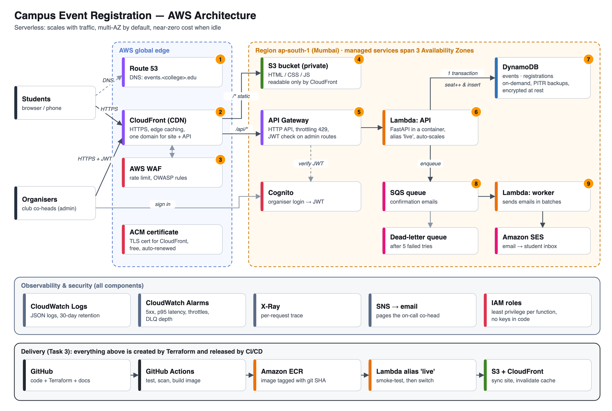

# Task 1 — Cloud Architecture Case Study

**Scenario:** a college event-registration website that must handle peak traffic, store data securely and stay available.
**Platform:** AWS, region `ap-south-1` (Mumbai, the closest region to Pune).
**Status:** designed, coded as Terraform (`infra/`), backend implemented and tested (`backend/`). Not deployed to a paid AWS account, following the guideline *"Do not purchase cloud services solely for recruitment"*. Everything except the optional WAF and custom domain fits in the AWS free tier.

---

## 1. Assumptions (what "peak traffic" means here)

| | Estimate | Why it matters |
|---|---|---|
| Students | ~10,000 | Upper bound of possible users |
| Popular event | 2,000–3,000 students try to register in the **first 5 minutes** after the link is shared on WhatsApp | Traffic goes from almost zero to a sharp spike, then back to zero |
| Peak API load | ~100 requests/s (page loads, seat checks, registrations) | Sizing input |
| Rest of the year | Close to zero traffic | Paying for idle servers would be wasteful |
| Budget | A student club: free tier, a few dollars a month at most | Rules out always-on servers and NAT gateways |

**Key insight:** the load is *spiky and mostly idle*. That is the textbook case for **serverless**: capacity appears when the spike arrives and costs nothing between events.

---

## 2. How a request flows (numbers match the diagram)

1. **Route 53** resolves `events.<college>.edu` to CloudFront.
2. **CloudFront** terminates HTTPS at the nearest edge location (several in India) using a free **ACM** certificate.
3. **AWS WAF** inspects the request: it blocks common attacks (SQL injection, XSS) and per-IP floods.
4. `/*` paths: CloudFront serves the HTML/CSS/JS from a **private S3 bucket**, cached at the edge.
5. `/api/*` paths: forwarded to **API Gateway (HTTP API)**, which applies throttling and, on admin routes, validates the organiser's **Cognito** JWT.
6. **Lambda (API)** runs the FastAPI application, packaged as a container image.
7. **DynamoDB** stores events and registrations. A registration is **one transaction**: "add 1 to the seat count *only if* seats remain" plus "insert the registration *only if* this email hasn't registered". Both succeed or neither does.
8. Lambda puts a message on an **SQS** queue and immediately returns "Confirmed" to the student.
9. A separate **worker Lambda** reads the queue and sends confirmation emails through **SES**. Messages that fail 5 times go to a **dead-letter queue**.

Across all components: **CloudWatch** (logs, metrics, alarms, dashboard), **X-Ray** (traces), **SNS** (alerts the on-call co-head) and **IAM** (one least-privilege role per function).

---

## 3. The six questions

### Where do the frontend and backend run?
- **Frontend:** static files in **S3**, delivered by **CloudFront**. No web server to run or patch. Edge caching makes pages fast everywhere and absorbs most of the traffic before it reaches AWS's regional services.
- **Backend:** **AWS Lambda** behind **API Gateway**. Code runs only when a request arrives. The same container image also runs locally with `docker compose` (see Task 3).
- **One domain for both:** CloudFront routes `/api/*` to API Gateway and everything else to S3. The browser only ever talks to one origin, which means no CORS configuration, one TLS certificate and one WAF in front of everything.

### How is data stored?
- **Amazon DynamoDB**, two tables, **on-demand** capacity:
  - `events`: key `event_id`, holds `capacity` and `registered_count`.
  - `registrations`: key `event_id` + `email`. The key itself guarantees one registration per email per event.
- **Correctness under load:** the transaction described in step 7 makes overbooking impossible, even when hundreds of students click at the same moment. I tested this with 50 concurrent requests for a 3-seat event: exactly 3 succeeded and 47 got "event full" (`scripts/concurrency_test.py`).
- **Protection:** encryption at rest (KMS) and in transit (TLS), **point-in-time recovery** (restore to any second in the last 35 days), and deletion protection on both tables.
- **Static files:** S3 with versioning (a bad upload can be rolled back) and server-side encryption, with all public access blocked.

### How do users access the website?
`https://events.<college>.edu` → Route 53 DNS → CloudFront (HTTPS only; HTTP is redirected) → S3 or API Gateway.
- **Students** don't need an account. That keeps friction low during the rush, and the email + student ID are validated server-side.
- **Organisers** sign in through **Cognito** and receive a short-lived JWT (1 hour). Only users in the `organisers` group can create events.

### How is increased traffic handled?
| Layer | Mechanism |
|---|---|
| CloudFront | Serves static files from edge caches, so the spike of page loads never reaches the region |
| API Gateway | Absorbs bursts. Throttling (200 req/s steady, 400 burst) returns `429` instead of letting a flood overwhelm the backend or the bill |
| Lambda | Each concurrent request gets its own execution environment. A function can add 1,000 concurrent environments every 10 seconds, up to the account quota |
| DynamoDB on-demand | Scales automatically, instantly handling up to double the previous peak. "Warm throughput" can pre-warm a table before a known big launch |
| SQS | Turns a burst of 2,000 confirmation emails into a queue processed steadily, so a slow email provider can't slow down registrations |

**Sizing check (Little's law):** concurrency ≈ requests/s × duration = 100 req/s × ~0.1 s ≈ **10 concurrent Lambdas**. That is far below the default regional quota of 1,000.
**Before a big event:** confirm the account's Lambda concurrency quota (new accounts can start lower) and run a load test.

### How is access secured?
- **Network edge:** HTTPS everywhere (TLS 1.2+), WAF managed rule groups plus a rate-based rule, and API Gateway throttling.
- **S3 is private:** only *our* CloudFront distribution can read it, through Origin Access Control and a bucket-policy condition on the distribution ARN.
- **Identity:**
  - Organisers authenticate with Cognito (strong passwords, optional MFA, admin-invite only).
  - API Gateway verifies the JWT before Lambda even runs.
  - The application double-checks group membership as defence in depth.
- **Least-privilege IAM:** the API function can only `GetItem/Scan/PutItem/UpdateItem` on its two tables and `SendMessage` to its one queue. It has no delete permission and no access to anything else.
- **No stored secrets:** functions use IAM roles, and CI/CD uses GitHub OIDC for temporary credentials, so no access keys exist anywhere.
- **Input validation:** Pydantic rejects malformed input with `422` before it reaches the database.
- **Data minimisation:** only name, email and student ID are collected. Logs hold IDs, not personal data, and expire after 30 days.

### What happens if a component fails?
| Failure | Effect | Mitigation |
|---|---|---|
| An Availability Zone goes down | None visible | Lambda, DynamoDB, SQS, S3 and API Gateway are all multi-AZ by design. There is no single server to lose |
| A bad code release | Errors after deploy | New version is smoke-tested *before* traffic; the `live` alias moves back to the previous version in seconds |
| A Lambda request crashes | One student sees an error | Every other request gets its own environment. The transaction means no half-written data. Alarm on `Errors` |
| Traffic exceeds quotas | `429`s and throttles | Throttles are an alarm; the frontend shows "try again". Raise the quota before big events |
| SES/email outage | Emails delayed, not lost | Registrations still succeed. SQS retries; after 5 tries the message goes to the DLQ (alarm) and can be replayed |
| Queue unreachable at registration time | Seat saved, email not queued | Logged and alarmed via a log metric filter (improvement: outbox pattern, see trade-offs) |
| Data deleted or corrupted | Lost registrations | Point-in-time recovery restores the table; deletion protection prevents accidents |
| Whole region down (very rare) | Site down | Accepted risk: multi-region would double cost and complexity for an event site. RTO = hours, by redeploying with Terraform in another region |

---

## 4. Trade-offs and alternatives considered

**Serverless (chosen) vs. containers or VMs behind a load balancer.** The alternative was ALB + ECS Fargate or EC2 Auto Scaling across 2 AZs, with RDS PostgreSQL Multi-AZ.

| | Serverless (chosen) | ALB + ECS/EC2 + RDS |
|---|---|---|
| Idle cost | ~$0 | ~$60–100/month (ALB, NAT gateway, RDS Multi-AZ, 2+ tasks) |
| Scaling for a sudden spike | Per-request, within seconds | Auto Scaling reacts in minutes, so you must pre-scale |
| Operations | No OS or patching | Patch AMIs/images, tune scaling policies |
| Long-running work / WebSockets | Limited (15 min max, cold starts) | Natural fit |
| Complex relational queries and reports | Harder (NoSQL) | Easy (SQL joins) |
| Vendor lock-in | Higher | Lower (containers move anywhere) |

**DynamoDB vs. RDS.** The access patterns are simple key lookups, and correctness is guaranteed by a conditional transaction. DynamoDB needs no connection pooling from Lambda, scales on demand and is multi-AZ by default.
- The cost: ad-hoc reporting ("registrations per branch") is harder.
- Mitigation: export to S3 and query with Athena.
- When to switch: if the club needs rich relational reporting, Aurora Serverless v2 is the natural choice.

**Cold starts.** The first request to a new Lambda environment takes ~0.5–1.5 s for a Python container. For a 5-minute rush this is acceptable. If not, **provisioned concurrency** can be scheduled for the launch window only.

**Known gaps I'd fix next:**
1. Requests can bypass CloudFront/WAF by calling the API Gateway URL directly. Fix: have CloudFront add a secret header that the API checks.
2. Use the transactional outbox pattern (or DynamoDB Streams) so an email can never be lost between the database write and the queue.
3. Add a short (2–5 s) CloudFront cache on `GET /api/events` to absorb read spikes, accepting slightly stale seat counts.
4. Add a waitlist when an event is full.

**Rough cost (one busy month, ~50k API calls, ~5k registrations):** Lambda, API Gateway, DynamoDB, SQS, S3, CloudFront and SES are within free tier or pennies. The fixed costs are optional:
- WAF: ~US$8/month
- Route 53 hosted zone: US$0.50/month

Verify with the AWS Pricing Calculator before deploying.

---

## 5. Where this lives in the code

| Concern | File |
|---|---|
| CDN, S3, Origin Access Control | `infra/frontend.tf` |
| API Gateway, Lambda, alias, IAM | `infra/api.tf` |
| Tables | `infra/database.tf` |
| Queue, DLQ, worker, SES | `infra/worker.tf` |
| WAF | `infra/waf.tf` |
| Cognito | `infra/auth.tf` |
| DNS and certificate | `infra/dns.tf` |
| Alarms and dashboard | `infra/monitoring.tf` |
| Seat-booking transaction | `backend/app/repository.py` |

## Sources
- AWS Well-Architected Framework — https://docs.aws.amazon.com/wellarchitected/latest/framework/welcome.html
- Lambda scaling behaviour — https://docs.aws.amazon.com/lambda/latest/dg/scaling-behavior.html
- DynamoDB transactions — https://docs.aws.amazon.com/amazondynamodb/latest/developerguide/transaction-apis.html
- DynamoDB on-demand capacity — https://docs.aws.amazon.com/amazondynamodb/latest/developerguide/on-demand-capacity-mode.html
- CloudFront Origin Access Control for S3 — https://docs.aws.amazon.com/AmazonCloudFront/latest/DeveloperGuide/private-content-restricting-access-to-s3.html
- API Gateway JWT authorizers — https://docs.aws.amazon.com/apigateway/latest/developerguide/http-api-jwt-authorizer.html
- API Gateway throttling — https://docs.aws.amazon.com/apigateway/latest/developerguide/http-api-throttling.html
- WAF rate-based rules — https://docs.aws.amazon.com/waf/latest/developerguide/waf-rule-statement-type-rate-based.html
- SQS with Lambda (partial batch failures) — https://docs.aws.amazon.com/lambda/latest/dg/services-sqs-errorhandling.html
- AWS Shared Responsibility Model — https://aws.amazon.com/compliance/shared-responsibility-model/
