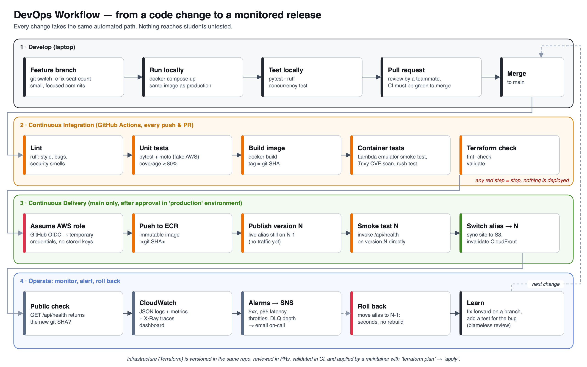

# Task 3 — DevOps and Deployment Workflow

**What this is:** a working repository, not only a description. It contains:
- the event-registration backend from Task 1 (`backend/`)
- a static frontend (`frontend/`)
- a Dockerfile and docker-compose setup
- Terraform for all the AWS infrastructure (`infra/`)
- a GitHub Actions CI/CD pipeline (`.github/workflows/ci-cd.yml`)
- monitoring defined as code

Every claim below points to the file that implements it.



---

## The path of one change, end to end

Example: a developer fixes the "event full" message.

1. **Branch:** `git switch -c fix-full-message`, edit `backend/app/main.py`, commit.
2. **Run and test locally:** `docker compose up --build`, then open http://localhost:8080. Run `pytest`.
3. **Push and open a pull request.** GitHub Actions runs **CI** automatically: lint → unit tests → build image → container tests, plus Terraform checks. A teammate reviews. Branch protection blocks merging until CI is green.
4. **Merge to `main`.** CI runs again on `main`, then the **deploy** job waits for approval in the `production` environment.
5. **CD:**
   1. Get temporary AWS credentials (OIDC).
   2. Push the image tagged with the commit SHA.
   3. Publish a new Lambda version.
   4. Smoke-test that version while it still receives no traffic.
   5. Switch the `live` alias to it.
   6. Upload the frontend and invalidate the CloudFront cache.
   7. Check `/api/health` returns the new SHA.
6. **Operate:** CloudWatch dashboards and alarms watch errors, latency, throttles and the email dead-letter queue. If anything breaks, the pipeline (or a human) moves the alias back to the previous version, which takes seconds.

---

## 1. Git and GitHub: tracking source code and changes

- **Git** records every change as a commit, with who, when, why (the message) and the exact diff. Any past state can be restored, and `git blame` / `git bisect` find which change introduced a bug.
- **Branches** isolate work in progress. `main` is always deployable.
- **Pull requests** are where changes are reviewed and CI must pass before merge. Recommended branch protection: require PR, require 1 approval, require the `ci-cd` checks.
- **Everything is in Git:** app code, tests, Dockerfile, Terraform, pipeline and docs, even the diagrams (`docs/diagrams/make_diagrams.py`). This is what "single source of truth" means.
- **Traceability:** the deployed image tag *is* the Git commit SHA. ECR tags are immutable, and `/api/health` reports the SHA, so for any running version you can find the exact commit behind it.
- **Never committed:** secrets, `.tfstate` and `.tfvars` (see `.gitignore`).

## 2. Build and testing: why check before release

A bug found on a laptop costs minutes. A bug found by 2,000 students during a registration rush costs the event. Tests run automatically on every change, at increasing cost and realism:

| Layer | Tool | What it proves | File |
|---|---|---|---|
| Lint | `ruff` (incl. bandit security rules) | Style, likely bugs, insecure patterns | `backend/pyproject.toml` |
| Unit tests (17) | `pytest` + `moto` (in-memory fake AWS) | Business rules: seats, duplicates, full events, validation, auth, worker retries. **Coverage gate ≥ 80%** (currently 87%) | `backend/tests/` |
| Container smoke test | AWS Lambda Runtime Interface Emulator | The *production image* starts and the Lambda handler answers an API Gateway event | `scripts/lambda_smoke_test.sh` |
| Vulnerability scan | Trivy | Fails on fixable CRITICAL CVEs in the image | CI workflow |
| Integration and concurrency test | docker compose + DynamoDB Local | 50 students race for 3 seats: exactly 3 succeed | `scripts/concurrency_test.py` |
| IaC checks | `terraform fmt` / `validate` | Infrastructure code is well-formed | CI workflow |

**Real example from building this project:** the unit tests failed the first time with `Attribute name is a reserved keyword: capacity`. DynamoDB reserves the word `capacity`, so the expression had to use a placeholder (`#capacity`). Without tests, this would have shipped, and *every* registration would have returned HTTP 500 in production.

## 3. CI/CD: automated workflows that test and deploy

- **CI (Continuous Integration):** every push and PR is built and tested automatically, so problems surface within minutes of the change that caused them.
- **CD (Continuous Delivery):** every green commit on `main` is releasable, and release is one approval click. Removing the approval gate would make it *Continuous Deployment*.

Pipeline (`.github/workflows/ci-cd.yml`):

```
test ──► container ──┐
   (lint, unit)      (build, emulator smoke,
                      Trivy, rush test)      ├──► deploy (main only, approval, OIDC)
terraform ───────────┘
   (fmt, validate)
```

Safety features worth pointing out:
- **No stored AWS keys.** GitHub's OIDC token is exchanged for 1-hour credentials. The IAM role trusts only this repo's `production` environment (`infra/github_oidc.tf`).
- **Least-privilege deploy role:** the pipeline can push images, publish and alias Lambda versions, sync S3 and invalidate CloudFront. It **cannot** change infrastructure, IAM or the data.
- **Test before traffic:** version *N* is published and invoked directly. Only after it passes does the `live` alias move from *N-1* to *N*.
- **Automatic rollback:** if any step after the switch fails, the alias is moved back to *N-1*.
- **Concurrency control:** a newer push cancels an older running pipeline on feature branches. On `main`, runs queue instead of cancelling, so a deploy is never cut off halfway.

## 4. Docker: containers for consistent environments

A **container image** packages the code *with* its exact runtime: OS libraries, Python 3.12 and pinned dependencies. A container is a running instance of that image. "Works on my machine" problems disappear because every environment runs the *same image*: laptop, CI and AWS Lambda.

`backend/Dockerfile` shows three ideas:
- **AWS's Lambda base image**, so production Lambda runs exactly what was tested.
- **Layer caching:** `requirements.txt` is copied and installed *before* the app code, so a code-only change rebuilds in seconds.
- **Multi-stage build:** a shared `base` stage, plus a `local` target (plain web server for laptops) and a default `lambda` target. Same code and dependencies, different start command.

`docker-compose.yml` starts the whole system locally with one command: DynamoDB Local, a seed job, the API, and nginx acting as CloudFront (same `/api/*` routing).

Containers vs. virtual machines: a VM virtualises hardware and boots a full OS (minutes, GBs). A container shares the host kernel and isolates only the process (seconds, MBs).

## 5. Infrastructure as Code: Terraform

All AWS resources (52 `resource` blocks) are declared in `infra/*.tf` instead of being clicked together in the console. Benefits:
- **Reproducible:** `terraform apply` builds an identical stack in a new account or region (e.g. a staging copy, or disaster recovery).
- **Reviewable:** infrastructure changes go through PRs like code. `terraform plan` shows exactly what will change before it changes.
- **Documented by definition:** the code *is* the up-to-date description of the system.

Workflow and concepts:
- `init` downloads providers (versions pinned in `.terraform.lock.hcl`).
- `plan` diffs the code against reality.
- `apply` makes the changes.
- **State** maps code to real resource IDs. It's stored remotely in S3 with locking (`versions.tf`), so a team shares one truth and two applies can't collide. State can contain sensitive values, so it is never committed.
- **Drift:** someone edits a resource in the console, and `plan` reveals the difference.

**Who owns what:** Terraform owns the *infrastructure*. The pipeline owns *releases* (image and alias version), which is why those two attributes are in `ignore_changes`. Otherwise every `terraform apply` would roll production back to an old image.

**First-time setup has an ordering problem:** Lambda can't be created until an image exists in ECR, and ECR is created by the same Terraform. It is solved in three steps:
1. `terraform apply -target=aws_ecr_repository.api`
2. Push a `bootstrap` image.
3. Full `terraform apply`.

The README has the exact commands.

## 6. Monitoring and logs: checking health and investigating problems

The three pillars, all defined in code (`infra/monitoring.tf`, `backend/app/logging_config.py`):

| Pillar | Implementation | Answers |
|---|---|---|
| **Metrics** | CloudWatch: API request count, 4xx/5xx, p50/p95/p99 latency, Lambda concurrency, errors, throttles, queue depth. One dashboard | *Is something wrong, and how bad?* |
| **Logs** | One JSON line per request (request id, path, status, duration_ms). 30-day retention. Queried with CloudWatch Logs Insights | *What exactly happened to this request?* |
| **Traces** | X-Ray on the API function | *Where did the time go: Lambda, DynamoDB or SQS?* |

- **Alarms → SNS → email** fire on things students would feel:
  - 5xx ≥ 5 in 5 min
  - p95 latency > 1.5 s
  - any Lambda throttling
  - any message in the email dead-letter queue
  - any failed email enqueue (a log metric filter turns a log message into a metric)
- **Health endpoints:** `/api/health` (liveness, returns the running Git SHA) and `/api/health/ready` (readiness, checks the database is reachable).
- **Request IDs:** every response carries `X-Request-Id`, the same ID as in the logs. When a student reports a problem with the reference shown on screen, you can find their exact log line.

**Example investigation (Logs Insights):**
```
fields @timestamp, request_id, path, status, duration_ms
| filter status >= 500
| sort @timestamp desc
| limit 50
```

---

## How to run it yourself
```bash
docker compose up --build                     # site on http://localhost:8080, API docs at /api/docs
cd backend && pip install -r requirements-dev.txt && pytest
python3 scripts/concurrency_test.py           # the registration-rush test
```

## Sources
- Git branching and PR flow — https://docs.github.com/en/get-started/using-github/github-flow
- GitHub Actions OIDC with AWS — https://docs.github.com/en/actions/security-for-github-actions/security-hardening-your-deployments/configuring-openid-connect-in-amazon-web-services
- Docker multi-stage builds — https://docs.docker.com/build/building/multi-stage/
- Lambda container images — https://docs.aws.amazon.com/lambda/latest/dg/images-create.html
- Lambda aliases and versions — https://docs.aws.amazon.com/lambda/latest/dg/configuration-aliases.html
- Terraform S3 backend and state locking — https://developer.hashicorp.com/terraform/language/backend/s3
- Twelve-Factor App: config in the environment — https://12factor.net/config
- Google SRE book, Monitoring Distributed Systems — https://sre.google/sre-book/monitoring-distributed-systems/
- DORA software delivery metrics — https://dora.dev/guides/dora-metrics-four-keys/
